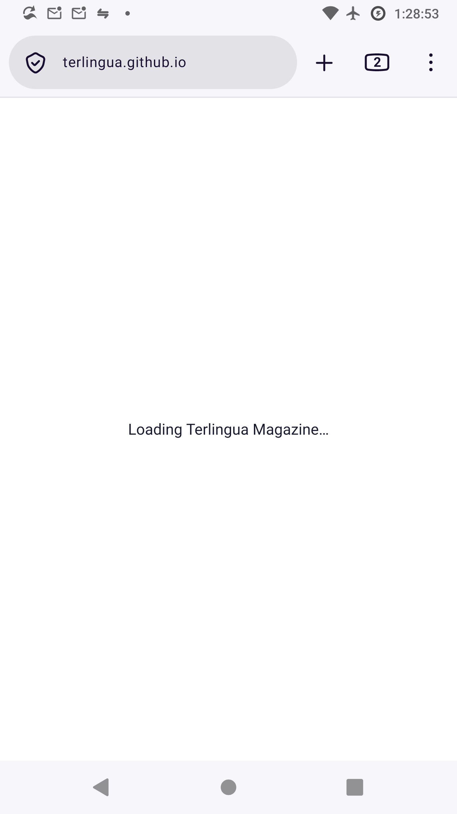
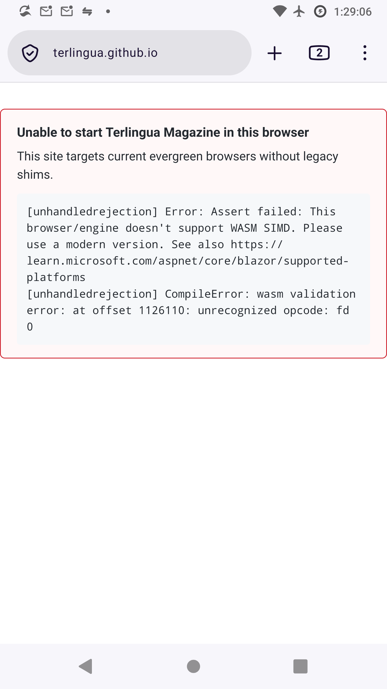
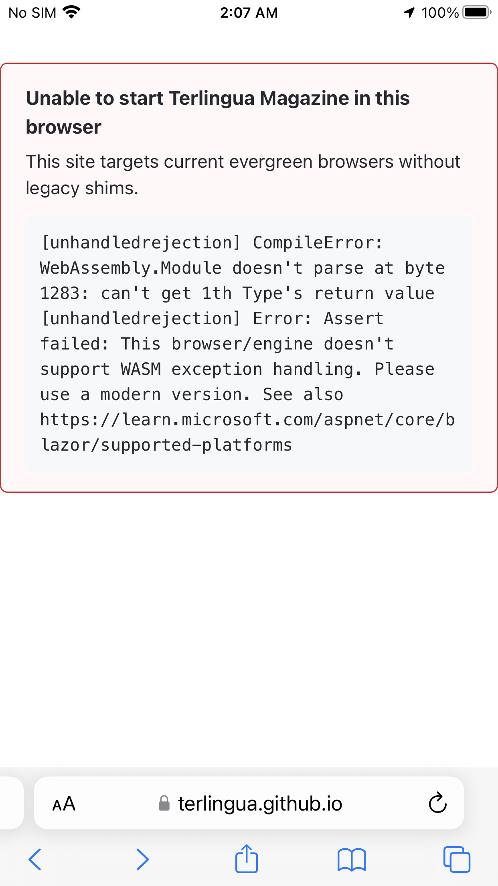

# Terlingua Magazine

A free, open-source Blazor WebAssembly application deployed to GitHub Pages.

Built with **.NET 11** and **C# 15**. Targets the current stable releases of evergreen browsers only
(Chrome, Edge, Firefox, Safari); there are no polyfills, vendor prefixes or legacy fallbacks.
Other browsers get an explicit error instead of a page stuck on loading (see
[Unsupported browsers](#unsupported-browsers)).

## Features

- **Blog** — Write posts in Markdown with YAML front matter; compiled to static JSON at build time
- **RSS Feed** — Auto-generated `feed.xml`
- **Books & Quizzes** — Multi-chapter books with single- and multiple-answer quizzes; reading progress stored in the browser (localStorage)
- **Responsive Tables** — Sortable, filterable data tables that work on mobile
- **Master-Detail Flow** — Click a list item to view full details
- **OpenTelemetry-ready Logging** — Structured logging via `ILogger`
- **Full Test Suite** — bUnit component tests + xUnit.net v3 integration tests, running on Microsoft.Testing.Platform

## Quick Start

`global.json` asks for SDK `11.0.100-rc.3` or any later 11.0.1xx SDK, so the Fedora RC 3 SDK works
locally and CI uses the latest .NET 11 GA SDK.

```bash
# Process blog posts and books
dotnet run --project tools/ObserverMagazine.ContentProcessor

# Run the app locally
dotnet run --project src/ObserverMagazine.Web

# Run all tests
dotnet test
```

## Books

Books live under `content/books/` and are compiled by the content processor into
`wwwroot/book-data/` (git-ignored) at build time.

```
content/books/
  blazor-basics/                  # book slug (lowercase, digits, hyphens)
    book.yml                      # title, author, summary, date, tags, image, draft
    01-getting-started/           # NN-chapter-slug; the number sets the order
      chapter.yml                 # title, summary, draft
      01-what-is-blazor.md        # NN-subchapter-slug.md
      02-project-structure.md
    02-components/
      ...
```

Chapters and subchapters are numbered 1, 2, 3… in the order of their prefixes, so gaps
(`01`, `05`, `10`) are fine. Drafts and future-dated books are skipped.

### Subchapter format

```markdown
---
title: What is Blazor WebAssembly?
questions:
  - id: runtime                   # optional, defaults to q1, q2…; keep stable once published
    prompt: Where does the C# code run?
    explanation: Shown after a correct answer.   # optional
    options:
      - text: On the server
      - text: In the browser
        correct: true
  - id: hosting
    prompt: Which statements are true?
    type: multiple                # optional: single | multiple
    options:
      - id: static                # optional, defaults to a, b, c…
        text: It can be served from GitHub Pages
        correct: true
      - text: It needs ASP.NET Core on the server
---
Markdown body…
```

- `type` is inferred when omitted: more than one correct option means `multiple`.
  Set `type: multiple` explicitly to use checkboxes even when only one option is correct.
- Prompts, options and explanations support Markdown (inline code, emphasis, links).
- Question and option ids are what reader progress is keyed on. Changing them resets
  progress for that question.
- Invalid content (no correct option, fewer than two options, unnumbered files, missing
  `chapter.yml`, bad YAML, duplicate ids) fails the build with a list of errors.

### Library

| Book | Slug | Focus |
|------|------|-------|
| Nutrition Science: What We Know and What We Don't | `nutrition-science` | Evidence-graded diet and nutrition: energy, macro- and micronutrients, patterns, disease, life stages, food safety, myths |
| .NET 10 and Modern C# | `modern-dotnet` | SDK, C# 14, async, hosting, minimal APIs, EF Core 10, architecture, testing, AOT |
| Timeless .NET: Modern C# 14 and .NET 10 Without the Vestiges | `timeless-dotnet` | Records, C# 14, tasks and async, cancellation tokens, DI, explicit mapping, modern Dapper, stored procedures vs parameterized SQL, xUnit v3 on MTP, .NET 11 and C# 15; spotting anachronisms, dogma, factoids and vestiges |
| Modern Web Development with Blazor | `modern-blazor` | Render modes, component reuse, forms, routing, state, interop, security, Hybrid |
| SOLID Principles in C# | `solid-principles` | The five principles, refactorings and trade-offs |
| Clean Code in C# | `clean-code` | Naming, functions, errors, classes, tests, smells, refactoring |
| Working Effectively with Legacy Code: A Companion | `working-effectively-with-legacy-code` | Chapter-by-chapter quizzes for Feathers' book: seams, characterization tests, sprouting and wrapping, the 24 dependency-breaking techniques |
| Dapper: Fast, Honest Data Access | `dapper` | Queries, parameters, mapping, transactions, architecture, testing |
| The Databricks Data Intelligence Platform | `databricks-platform` | Spark, Delta Lake, Unity Catalog, pipelines, jobs, SQL, MLflow, GenAI |
| Databricks Fundamentals: The Platform Without the Brochure | `databricks-fundamentals` | Companion to the Databricks Fundamentals course: lakehouse, control and compute planes, DBUs and cost, Lakeflow, Databricks SQL and Genie, MLflow and serving, Unity Catalog, workspace, lock-in and when not to use Databricks |
| Generative AI Fundamentals: How It Works, Where It Fails | `generative-ai-fundamentals` | Companion to the Generative AI Fundamentals course: tokens, embeddings, training and alignment, decoding, hallucination, prompting and injection, RAG, fine-tuning, evaluation, economics, regulation, GenAI on Databricks |
| AI Agent Fundamentals: From Loops to Production | `ai-agent-fundamentals` | Companion to the AI Agent Fundamentals course: tools, memory, planning, workflow patterns, multi-agent systems, MCP and A2A, Agent Bricks, evaluation, the lethal trifecta, ROI, agents in .NET with Microsoft.Extensions.AI, Agent Framework, MCP and C# 15 |
| Designing Data-Intensive Applications (2nd Edition): A Companion | `designing-data-intensive-applications` | Chapter-by-chapter companion to Kleppmann and Riccomini's second edition: foundations checks, links to today's cloud, streaming and AI systems, explanations that quote the book |
| Statistical Rethinking (2nd Edition): A Companion for Software Engineers | `statistical-rethinking` | Concept-first companion to McElreath's second edition: Bayesian updating, sampling, linear and generalized linear models, DAGs and confounding, overfitting and PSIS/WAIC, interactions, MCMC and HMC, maximum entropy, multilevel and covariance models, measurement error and missing data, scientific models; explanations quote the book with page pointers, questions framed in software, DevOps and telemetry settings |
| In Pursuit of the Traveling Salesman: A Concept Companion for Software Engineers | `in-pursuit-of-the-traveling-salesman` | Chapter-by-chapter companion to Cook's book: tours and graphs, the √n law, applications as modeling patterns, heuristics from nearest neighbor to LKH and EAX, LP and duality, subtour and comb cuts, separation via max-flow, branch-and-cut, Concorde and certificates, P vs NP, Held–Karp, approximation limits; explanations quote the book with page pointers, plus a 2011–2026 update chapter and capstone review |
| Sustainable Energy — Without the Hot Air: A Quiz Companion | `sustainable-energy-without-the-hot-air` | Self-test companion to MacKay's free book: chapters 1–32 as in the book, technical chapters A–H as 33–40, data chapters I–K as 41–43, with page pointers |
| Social Psychology (12th Edition): A Companion for Software Engineers | `social-psychology` | Concept-first companion to Aronson, Lewis, Page-Gould, Sommers and Wilson's twelfth edition: construal and the power of the situation, methods and open science, culture, the self and dissonance, heuristics, attribution, persuasion, prejudice, groups, conformity and obedience, helping, aggression, relationships, and the applied chapters on sustainability, health and law, plus a cross-chapter review; explanations quote the book's definitions with page pointers, questions framed in incident response, code review, hiring and team settings |
| Microsoft Azure for .NET Developers | `microsoft-azure` | Identity, compute, data, messaging, networking, Bicep, governance |
| Amazon Web Services for Builders | `amazon-web-services` | IAM, compute, storage, databases, integration, VPC, IaC, cost |
| Blazor WebAssembly Basics | `blazor-basics` | A short introduction |

Content guidelines for new sections:

- Open with a "Learning objectives" list and keep each section focused on one concept
- Prefer small, compilable code snippets with a language on every code fence
- Write three or more questions per section, mixing single- and multiple-answer questions,
  with an `explanation` on every question
- Vary the position of the correct option; the UI does not shuffle options
- Companions to published books follow the original chapter and section order, quote only short passages, and put each quotation inside “ ” in the `explanation` so it can be checked against the source
- Non-software books may grade claims by certainty; `nutrition-science` uses Established, Strong, Uncertain and Not supported, and cites sources at the end of each section
- Quote option text that YAML would read as a boolean, number or null (`"Yes"`, `"50"`), and avoid `yes`, `no`, `null`, `true` and `false` as ids
- Quote YAML values that contain `: `, ` #` or start with a backtick or `@`

### Progress and analytics

- A section is complete when every question has been answered correctly, or, if it has
  no questions, once it has been opened.
- Progress is saved per book in `localStorage` under `book:<slug>`. If storage is
  unavailable (blocked storage, quota) the app falls back to in-memory storage and tells
  the reader that progress will not persist.
- When the analytics backend is reachable, the reader count of a book and of each
  section is shown. A reader is counted once per book and once per section, using the
  local progress record to avoid counting repeat visits. Quiz answers are sent as
  interaction events. Nothing is shown and nothing breaks when the backend is down.

## Front end

- The site ships no JavaScript of its own apart from the inline boot-failure reporter in
  `index.html` (see [Unsupported browsers](#unsupported-browsers)). The only interop is
  `localStorage` through `LocalBrowserStorage` (`IBrowserStorage`), which wraps every call in
  `try`/`catch` as analyzer BL0016 requires.
- Code blocks are highlighted at build time by `SyntaxHighlighter` in the content processor,
  plugged into Markdig as `SyntaxHighlightingExtension`. The `hl-*` colour classes live in
  `app.css`.
- Horizontally scrolling code blocks show edge shadows with pure CSS
  (`background-attachment: local`).
- Themes are CSS custom properties. `MainLayout` renders `data-theme` on `.page` and saves the
  choice in `localStorage` (`observer-theme`). The default `system` theme uses `light-dark()`
  and `color-scheme`, so it follows the OS setting live. The loading screen always uses the
  system theme.
- The audio player uses the browser's native controls, including playback speed, and stays
  hidden until the MP3's metadata loads.
- `OverrideHtmlAssetPlaceholders` fingerprints the framework files (`dotnet.js` is published as
  `dotnet.<hash>.js`) and fills the `<script type="importmap">` placeholder in `index.html`,
  which is how `blazor.webassembly.js` finds them. Keep that placeholder, and don't modify files
  under `_framework` after publish, because the import map can carry integrity hashes for them.
  A 404 for `/_framework/dotnet.js` on the live site is expected.
- GitHub Pages deep links work because CI copies the published `index.html` to `404.html`.

### Unsupported browsers

`index.html` makes the app fail loudly instead of leaving "Loading Terlingua Magazine…" on screen
forever. Both failure states use the `.app-failure` card in `app.css`, built from the same design
tokens as the rest of the site.

- **JavaScript off.** A `<noscript>` card inside `#app` says JavaScript is required, and a
  `<noscript>` style in `<head>` hides the loading text.
- **Boot failure.** An inline classic script, placed before `blazor.webassembly.js`, listens for
  `error` (capture phase) and `unhandledrejection`. On the first one it replaces the loading text
  with a copy of `<template id="boot-error-template">` and appends one line per error:
  `[unhandledrejection]` for rejected promises such as WebAssembly compile errors and runtime
  feature checks, `[error]` for script errors such as syntax the browser can't parse, and
  `[resource error]` for a `<script>` that fails to load. Other failed resources (stylesheets,
  images) are ignored because they don't stop the app.
- **After boot** the reporter does nothing: Blazor clears `#app` when it renders, so the loading
  text is gone and later errors go to `#blazor-error-ui` as before.
- The reporter is the one place where older browsers matter, because it has to run where the app
  can't. It uses ES2015 syntax and DOM APIs that any browser with WebAssembly support understands.
  It sets text with `textContent` only. Keep it before `blazor.webassembly.js` and keep it a
  classic script, not a module.
- `app.css` uses `light-dark()`, which these browsers ignore, so the card falls back to the
  browser's default colours. That is expected; it stays readable and needs no fallback.

Before, an iPhone 8 Plus or a Nexus 6 sat on the loading text with no explanation:



Now they report why the runtime can't start (no WebAssembly SIMD on the Nexus 6, no WebAssembly
exception handling on the iPhone 8 Plus):

 

To check the boot-failure path locally, block `_framework/blazor.webassembly*.js` in the browser
dev tools' network panel and reload; the card shows a `[resource error]` line. To check the
no-JavaScript path, turn JavaScript off for the site and reload.

## Testing

Tests run on **Microsoft.Testing.Platform (MTP)**, not VSTest. The opt-in lives in
`global.json`:

```json
{ "test": { "runner": "Microsoft.Testing.Platform" } }
```

Test projects are ordinary executables, so each one can also be run on its own:

```bash
# Whole solution
dotnet test --solution ObserverMagazine.slnx

# One project
dotnet test --project tests/ObserverMagazine.Web.Tests

# Filter by class, or by trait
dotnet test --filter-class ObserverMagazine.Web.Tests.Services.BlogServiceTests
dotnet test --filter-trait Category=Integration

# Run a test project directly, no dotnet test involved
dotnet run --project tests/ObserverMagazine.Integration.Tests
```

Run `dotnet test -?` from the repo root for the full option list, which is built
from whichever MTP extensions the test projects reference.

xUnit configuration for MTP lives in `testconfig.json` next to a test project
(not `xunit.runner.json`, which is the VSTest-era file).

## LLM context export

`export.sh` writes `docs/llm/dump.txt`, a single-file snapshot of the repository for LLM
project knowledge. To keep it small it includes full text only for source, config and docs.
Blog posts contribute front matter, books one inventory line each (the book format is
documented above), and binary and data files (`wwwroot/plaintext/`) their path. `docs/` is
never exported. The script prints the dump's size and largest files when it finishes.

```bash
bash export.sh                                   # whole repository
bash export.sh -- ':!tests' ':!*Showcase*'       # narrow with git pathspecs
bash export.sh -f -o /tmp/dapper.txt -- content/books/dapper   # full text of one book
```

## Technology

| Component | Technology | License |
|-----------|-----------|---------|
| Framework | .NET 11 / Blazor WASM 11.0.0 | MIT |
| Markdown | Markdig 1.6.0 | BSD-2-Clause |
| YAML | YamlDotNet 18.1.0 | MIT |
| Test framework | xUnit.net v3 4.0.3 | Apache-2.0 |
| Component testing | bUnit 2.15.2 | MIT |
| Test runner | Microsoft.Testing.Platform v2 | MIT |

All dependencies are free for any use — no payment required, ever.

## License

AGPLv3
